# Multi-Edit Revisited (mr)

> - "I live again." Caleb (Blood)
> - "It is never enough." Frank Cotton (Hellraiser)
> - "C makes it easy to shoot yourself in the foot; C++ makes it harder, but when you do it blows your whole leg off." Bjarne Stroustrup
> - "Talk is cheap. Show me the code." Linus Torvalds
> - "My main conclusion after spending ten years of my life working on the TeX project is that software is hard. It's harder than anything else I've ever had to do." Donald Knuth
> - "Coding makes me horny." Michael 'iDoc' Raus
> - "Software and cathedrals are much the same – first we build them, then we pray." Sam Redwine
> - "There are only two hard things in Computer Science: cache invalidation and naming things." Phil Karlton
> - "Theory is when you know everything but nothing works. Practice is when everything works but no one knows why. In programming, theory and practice are combined: nothing works and no one knows why." Anonymous
> - "Everyone knows that debugging is twice as hard as writing a program in the first place. So if you're as clever as you can be when you write it, how will you ever debug it?" Brian W. Kernighan
> - "Software is getting slower more rapidly than hardware becomes faster." Niklaus Wirth
> - "Code never lies; comments sometimes do." Ron Jeffries
> - "Software is a gas. It expands to fit the container it's in." Nathan Myhrvold
> - "The three chief virtues of a programmer are: Laziness, Impatience and Hubris." Larry Wall

## Manuals (PDF)

### [MR Users Manual](documentation/manuals/mr-users-manual.pdf)

A practical guide to installing and using MR: editing and navigation, block operations, search and replace, windows and workspaces, configuration, compiler tools, and debugging.

### [MRMAC Reference Manual](documentation/manuals/mr-macro-reference.pdf)

The reference for MR's macro language, covering syntax, data types, commands, functions, and example macros for editor automation and custom user interfaces.

### [MR Technical Manual](documentation/manuals/mr-technical-manual.pdf)

An explanation of MR's architecture and engineering decisions, including large-file editing, document storage, the coprocessor, the MRMAC compiler and virtual machine, and TVision integration.

## Look at the size of that thing!

- American Cybernetics (the makers of Multi-Edit) went out of business in 2020, having stopped development of the TUI version of Multi-Edit years earlier.
- mr is a rewrite of American Cybernetics' classic programmer's editor, Multi-Edit, for Linux terminals.
- mr is built around a macro language processor that compiles macro files based on the MEMAC scripting language. Now called MRMAC, the language retains source compatibility with the MEMAC dialect while being updated and extended for modern systems. Compilation takes place in RAM through the custom mrmac compiler, with support for both precompiled macros and macros compiled on demand for maximum speed. One of the screenshots shows mr running a calculator utility written in MRMAC.
- mr uses:
  - TVISION, magiblot's C++ rewrite of Turbo Vision on GitHub.
  - Advanced data structures such as piece tables, add buffers, and tries to edit files larger than system memory and provide blazing-fast file I/O: it loads 1 GB of text in under one second and indexes the entire text in under 800 milliseconds (no BS).
  - A built-in coprocessor for running mrmac bytecode macros that can manipulate text while the user edits text in the same window. The coprocessor supports multiple macro jobs running in parallel across different windows, within a single window, or both at the same time. It uses multiple execution lanes in parallel: I/O, COMPUTE, MACRO, and MINIMAP.
  - A built-in virtual machine to execute MRMAC macros as precompiled bytecode.
  - ncursesw, with support for UTF-8.
- mr supports:
  - Automatic syntax highlighting, code folding, and smart indentation for all known programming languages.
  - A macro manager for recording macros and binding them to hotkeys. You can create, manage, edit, and bind .mrmac files within the manager.
  - Virtual desktops.
  - Workspaces: loading, saving, automatic loading and saving, and workspace-wide search and replace across multiple files.
  - A window manager that can tile, minimize, cascade, close, hide, show, save, and discard windows.
  - Recursive search and replace across multiple files.
  - Full support for Perl-compatible regular expressions through PCRE2.
  - A minimap display with subcharacter resolution.
  - Copy and paste between windows and through the operating system clipboard.
  - Stream, line, and column blocks, including sorting within the selected block.
  - A key mapping manager and loadable key mappings to emulate editors such as Emacs, Nano, or WordStar.
  - Profiles for individual file extensions or groups of extensions, allowing you to configure file handling for the code you edit.
  - Loading and saving color themes through file extension profiles.
  - Automatic language detection with syntax highlighting.
  - Automatic graphical code folding at multiple levels.
  - Smart indentation and unindentation.
  - Myers file comparison with colored hunks and editing in both directions.
  - An integrated display of Git changes.
  - Printing through PDF export.
  - Line drawing within documents, including boxes and single or double lines that connect automatically.
  - File acquisition from the output of shell commands or pipes.
  - Compiler profiles with automatic setup and error tracking in the source code.
  - GDB integration for many languages, with visual debugging inside mr, including stepping, variable editing, watches, an integrated ANSI/VT terminal, and much more.
  - MULTITHREADED DEBUGGING: follow execution into threads, use scope-aware Variables and Watches panes, switch contexts, use breakpoints while debugging threads, and view synchronized source panes side by side for selected threads.
  - An in-editor library API reference.
  - Code snippets.
  - Hex editors with synchronized hexadecimal, decimal, octal, string, and binary views, plus an additional data inspector.
  - A wide range of configuration options for your user experience.
  - Many, many more features.

## Why? Who needs this?

- No one needs this: there are many good TUI editors out there.
- Everybody needs this: none of the console editors around are this elegant and feature-rich. mr aims to be there whenever you need a TUI editor to manage your system, files, and codebases, or want IDE features in your terminal.
- Why, you ask? I always wanted Multi-Edit back, and it was the TUI version that inspired me back in the day. I had ideas for this project for years. After I retired in 2024, I had time to get those ideas out of my head and into code. I wanted to see what all the fuss over AI and coding assistants was about. I wanted assistance with the tedious parts; I was not interested in vibe coding, and I still am not. I tried several coding assistants and found that Codex best matched my needs and preferred way of interacting.

## Showtime

<table>
  <tr>
    <td width="50%">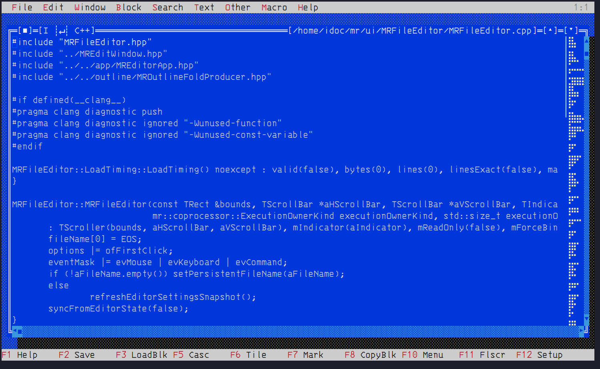</td>
    <td width="50%">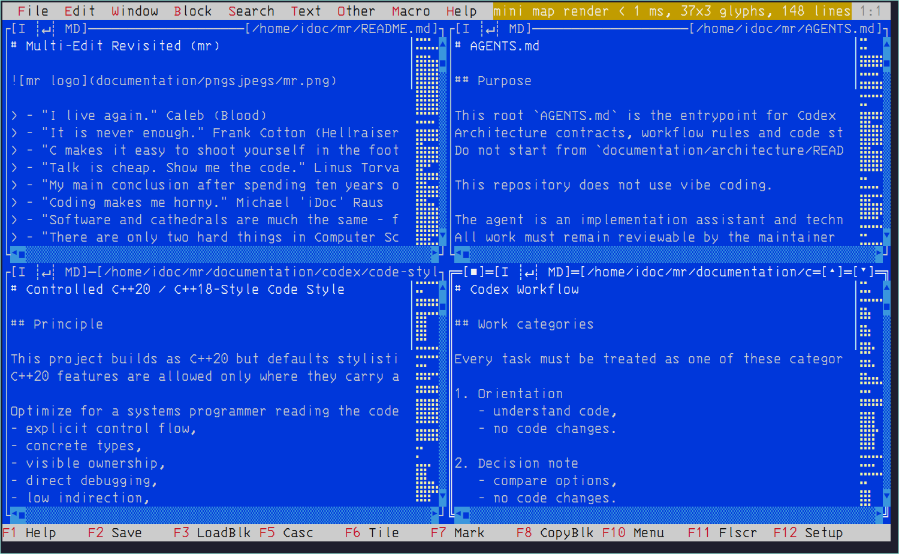</td>
  </tr>
  <tr>
    <td width="50%">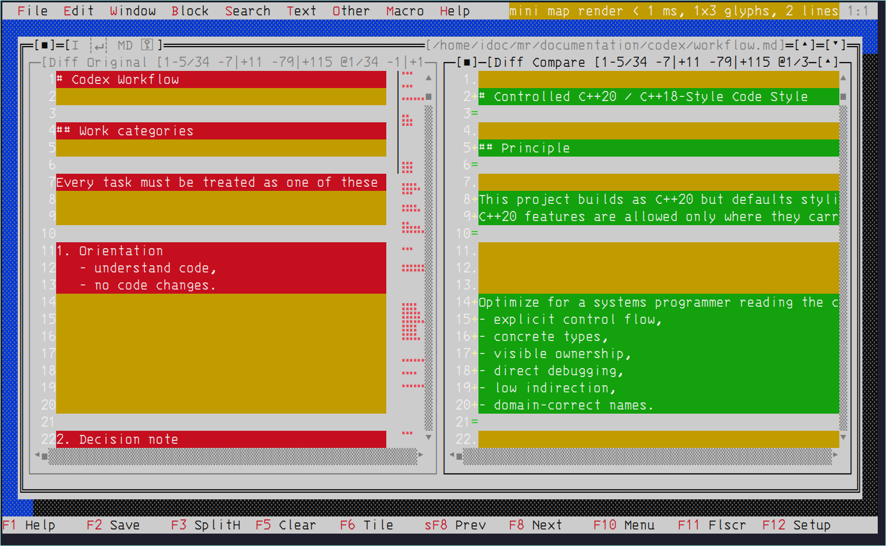</td>
    <td width="50%">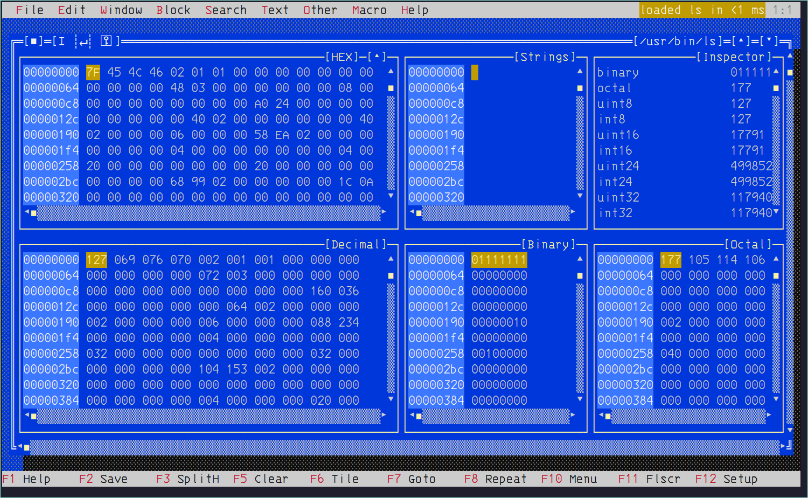</td>
  </tr>
  <tr>
    <td width="50%">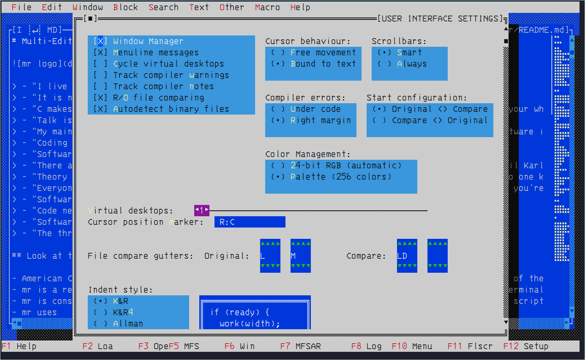</td>
    <td width="50%">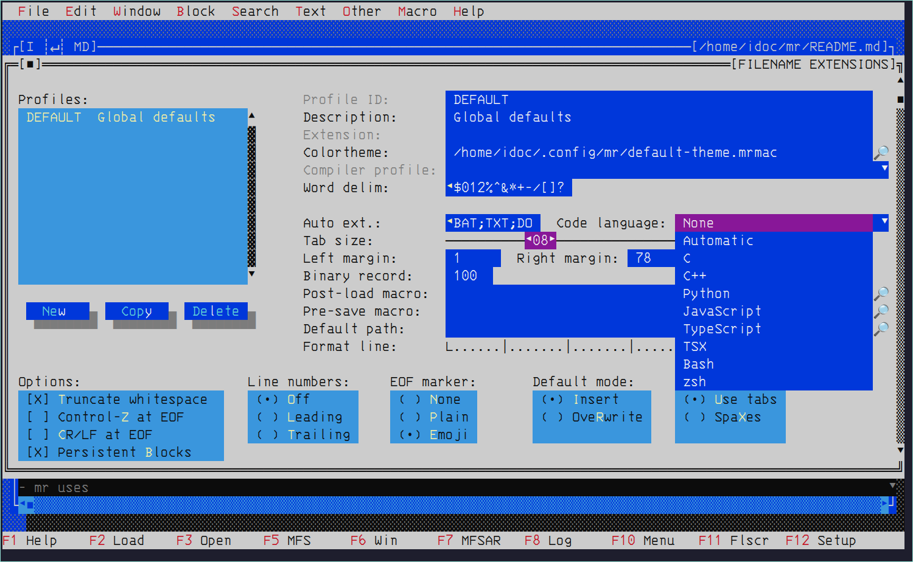</td>
  </tr>
  <tr>
    <td width="50%">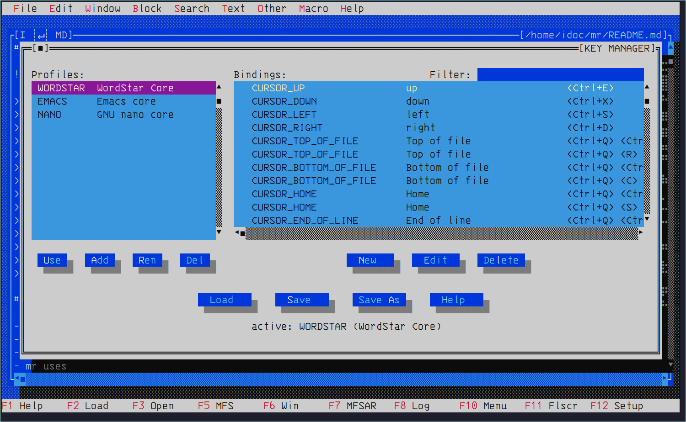</td>
    <td width="50%">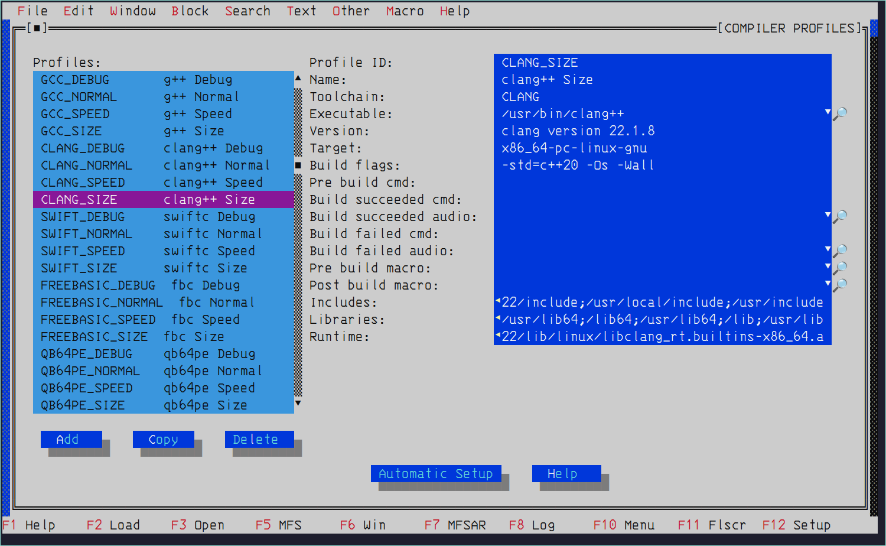</td>
  </tr>
  <tr>
    <td width="50%">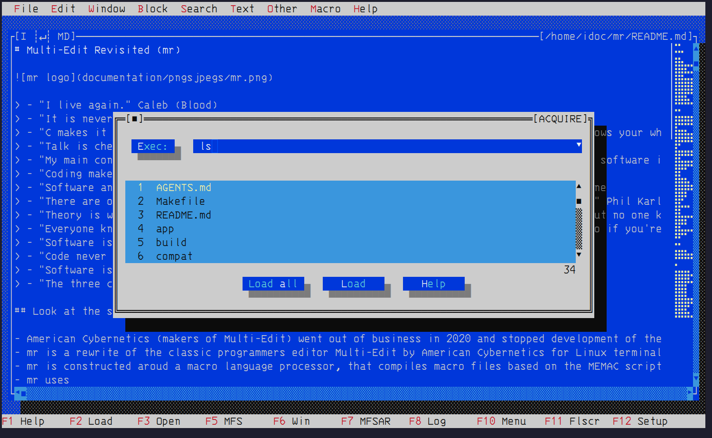</td>
    <td width="50%">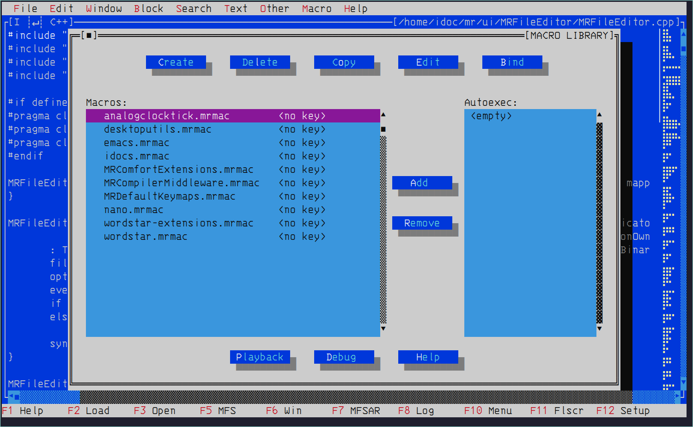</td>
  </tr>
  <tr>
    <td width="50%">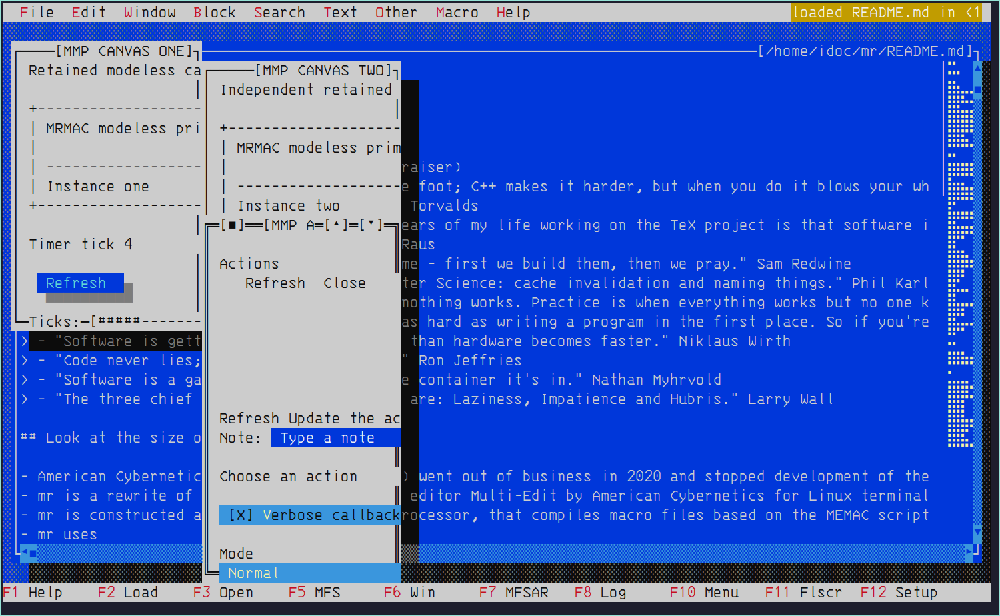</td>
    <td width="50%">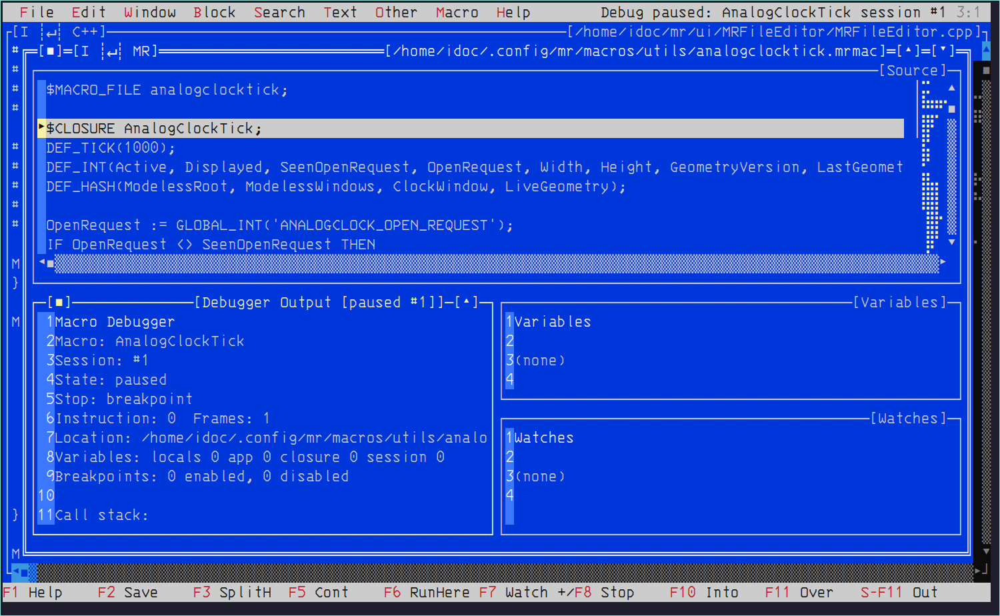</td>
  </tr>
  <tr>
    <td width="50%">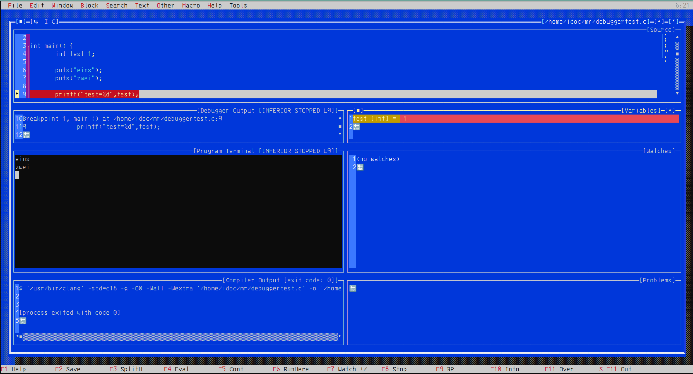</td>

  </tr>
</table>
